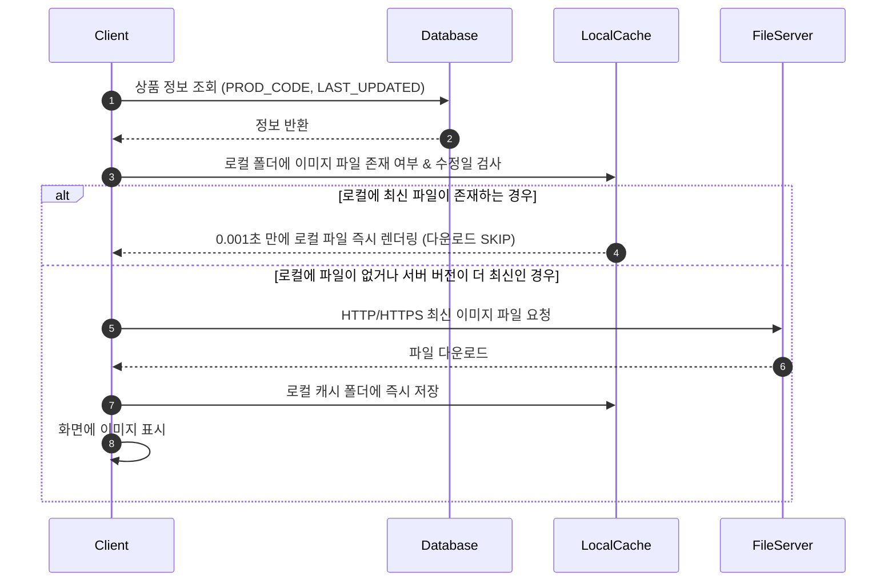

# ERP 대용량 상품 이미지 자산 관리 및 보안/성능 최적화 가이드

본 문서는 대규모 ERP, 쇼핑몰, 물류 관리 시스템 등에서 수만 개 이상의 **상품 이미지 및 미디어 자산을 효율적이고 안전하게 관리하기 위한 아키텍처 설계 및 델파이(Delphi 7) 구현 가이드**입니다.

---

## 📌 1. 개요 및 설계 도전 과제

ERP 시스템 구축 시 상품 이미지 데이터가 수만~수십만 건 이상 누적되면 다음과 같은 문제에 직면합니다:

1. **DB 용량 폭발**: 이미지 바이너리를 DB에 직접 저장 시 DB 백업/복구에 수 시간이 소요되고 DB 호스팅 비용 급증
2. **네트워크 트래픽 과부하**: 목록 조회가 일어날 때마다 무거운 이미지를 가져와 화면 응답 속도 저하
3. **보안 및 자산 도용 이슈**: 이미지가 일반 JPG/PNG 파일로 폴더에 공개 노출 시 무단 복제 및 디자인 유출 위험

이러한 문제를 해결하기 위해 **[DB-파일서버 분리 설계]**, **[클라이언트 차분 캐싱]**, **[바이너리 패키징 & 헤더 마스킹]**의 3가지 핵심 실무 아키텍처 패턴을 적용합니다.

---

## 🏗️ 2. DB vs 파일 스토리지 분리 아키텍처

### ❌ DB 직접 저장 (BLOB/VARBINARY) - 비추천
- **방식**: DB 테이블의 `IMAGE_DATA` (`BLOB` / `VARBINARY(MAX)`) 칼럼에 이미지 자체를 쿼리로 저장
- **문제점**: DB 크기가 수백 GB로 비대해지며, `SELECT` 시 메모리 병목 및 DB 전체 쿼리 속도 저하 발생 (서명 등 보안 특수 목적 외 절대 금지)

### ⭕ DB-파일 스토리지 분리 방식 - 실무 90% 이상 채택 (권장)
- **방식**: DB에는 이미지의 **상대 경로/파일명(`VARCHAR`)** 만 저장하고, 실제 파일은 파일 서버(NAS/S3/HTTP)에 보관

```text
[DB Table: PRODUCTS]
PROD_CODE  PROD_NAME          PRICE    IMAGE_PATH               LAST_UPDATED
--------------------------------------------------------------------------------------
P1001      모던 라운드 체어   150000   /images/prod/P1001.dat   2026-07-29 14:00:00
P1002      스마트 오피스 책상 230000   /images/prod/P1002.dat   2026-07-29 14:05:00
```

### 💡 썸네일(Thumbnail)과 원본의 분리 (성능 극대화 패턴)
- **목록 화면 (`TDBGrid` / `TListView`)**: 100x100 크기의 **소형 썸네일(수 KB)** 만 조회 및 그리드 렌더링
- **상세 팝업 화면**: 사용자가 특정 상품을 클릭했을 때만 **고화질 원본 이미지(수 MB)** 를 다운로드 및 로드

---

## ⚡ 3. 클라이언트 차분 동기화 & 로컬 캐싱 (Client Caching)

모든 요청마다 서버에서 이미지를 매번 받아오면 속도가 느려지므로, 사용자 PC(로컬 캐시)에 다운로드 후 **변경된 파일만 차분 동기화(Differential Sync)** 합니다.



---

## 🔒 4. 보안 및 성능을 위한 `.dat` / `.pak` 패키징 기술

상용 ERP 및 게임 시스템에서 이미지 확장자를 `.jpg`가 아닌 **`.dat`**, **`.bin`**, **`.pak`** 으로 사용하는 핵심 이유입니다:

### 1) 무단 도용 방지 (Resource Security)
- 확장자를 `.dat`으로 변경하고 파일 헤더 바이트에 **Simple XOR / AES 마스킹**을 적용하면, 탐색기나 알씨 등 일반 뷰어 프로그램에서 파일이 열리지 않음 (`"알 수 없는 파일 형식입니다"`).
- 오직 전용 ERP 델파이 프로그램 내부 메모리에서만 정해진 Key로 복호화되어 표시됩니다.

### 2) Disk I/O 병목 방지 (Small File Overhead)
- 윈도우 파일 시스템(NTFS)은 1~2KB의 자잘한 파일 수만 개를 개별 탐색/Open하는 것에 심각한 디스크 I/O 렉을 발생시킵니다.
- 카테고리별 100개~1,000개 단위로 묶어서 하나의 바이너리 패키지 파일(`category_cloth.dat`)로 압축하여 다운로드 후 메모리에서 잘라 사용합니다.

---

## 💻 5. 델파이 7 (Delphi 7) 실무 구현 예제 소스

### 1) HTTP 차분 다운로드 및 로컬 캐싱 처리 함수

```delphi
uses
  SysUtils, Classes, IdHTTP, Windows;

// 로컬 캐시 파일 날짜 구하기
function GetFileDateTime(const AFileName: string): TDateTime;
var
  Age: Integer;
begin
  Age := FileAge(AFileName);
  if Age <> -1 then
    Result := FileDateToDateTime(Age)
  else
    Result := 0;
end;

// 스마트 차분 다운로드 함수 (HTTP 이용 - 방화벽 안전)
function GetSmartCachedImage(const AServerURL, AFileName: string; AServerModDate: TDateTime): string;
var
  LocalCachePath: string;
  IdHTTP: TIdHTTP;
  FS: TFileStream;
begin
  // 로컬 캐시 디렉터리 지정
  LocalCachePath := ExtractFilePath(ParamStr(0)) + 'Cache\' + AFileName;
  ForceDirectories(ExtractFilePath(LocalCachePath));

  // 1. 로컬에 파일이 없거나, 서버의 수정일자가 더 최근이면 다운로드 진행
  if (not FileExists(LocalCachePath)) or (GetFileDateTime(LocalCachePath) < AServerModDate) then
  begin
    IdHTTP := TIdHTTP.Create(nil);
    FS := TFileStream.Create(LocalCachePath, fmCreate);
    try
      IdHTTP.ConnectTimeout := 3000;
      IdHTTP.ReadTimeout := 5000;
      IdHTTP.Get(AServerURL + '/' + AFileName, FS);
    finally
      FS.Free;
      IdHTTP.Free;
    end;
  end;

  Result := LocalCachePath; // 로컬 파일 경로 반환
end;
```

### 2) `.dat` 암호화 파일(XOR 마스킹)을 임시 저장 없이 메모리에서 `TImage`로 그리기

```delphi
uses
  Graphics, ExtCtrls, Classes, JPEG; // JPEG 유닛 포함 필수

procedure LoadMaskedDatToImage(const ADatFilePath: string; AImage: TImage);
var
  MS: TMemoryStream;
  Buffer: PAnsiChar;
  I, MaskLen: Integer;
  JPegImg: TJPEGImage;
const
  XOR_KEY = $FF; // 헤더 마스킹 키
begin
  if not FileExists(ADatFilePath) then Exit;

  MS := TMemoryStream.Create;
  JPegImg := TJPEGImage.Create;
  try
    MS.LoadFromFile(ADatFilePath);

    // 1. 파일 상위 16바이트 헤더 마스킹 즉시 암호 해제 (메모리상에서만 원복!)
    Buffer := MS.Memory;
    MaskLen := 16;
    if MS.Size < MaskLen then MaskLen := MS.Size;

    for I := 0 to MaskLen - 1 do
      Buffer[I] := AnsiChar(Byte(Buffer[I]) xor XOR_KEY);

    // 2. 디스크에 임시파일을 쓰지 않고 메모리 스트림(TMemoryStream)에서 바로 로딩!
    MS.Position := 0;
    JPegImg.LoadFromStream(MS);

    AImage.Picture.Assign(JPegImg);
    AImage.Stretch := True;
    AImage.Proportional := True;
  finally
    JPegImg.Free;
    MS.Free;
  end;
end;
```

---

## 📋 6. 실무 체크리스트 요약

| 구분 | 고려 항목 | 추천 방식 및 실무 규칙 |
| :--- | :--- | :--- |
| **저장 방식** | DB vs 파일 서버 | **DB에는 경로만 저장**, 파일은 HTTP/NAS 서버에 보관 |
| **속도 최적화** | 이미지 다운로드 | **로컬 PC 캐싱** 적용 (수정 날짜 비교 후 차분 다운로드) |
| **화면 최적화** | 목록 및 상세 보기 | 목록은 **100x100 썸네일**, 상세창은 **원본 이미지** 분리 |
| **자산 보안** | 파일 노출 방지 | `.jpg` ➔ **`.dat` 확장자 변경 + 헤더 XOR 마스킹** 적용 |
| **프로토콜** | FTP vs HTTP | 방화벽 유연성을 위해 **HTTP/HTTPS (포트 80/443)** 사용 |
